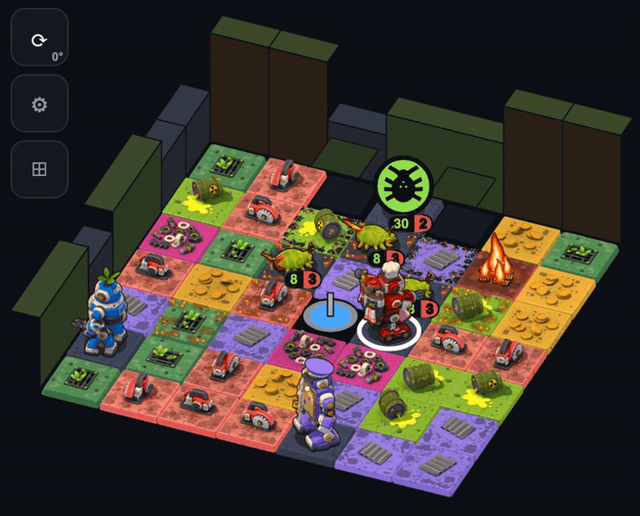
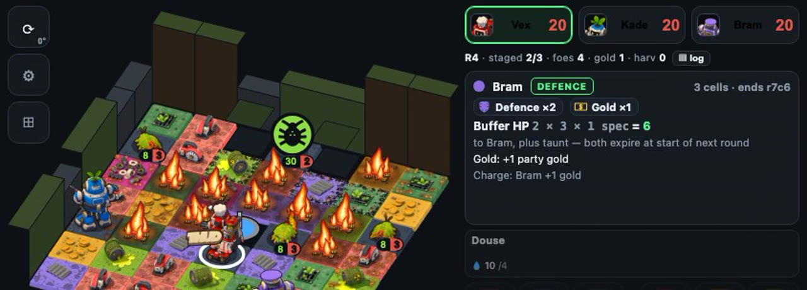

# A Table For Four

**A grid-tactics game about a kitchen robot with a shopping list, in a world
that ended a long time ago. Only the robot hasn't noticed.**

  

Vex wakes up under the cereal in aisle seven with a handwritten grocery list
and one job: get everything on it, and cook dinner for the family. The
supermarket is overgrown and the wildlife has mutated. Vex treats all of it
as an unusually difficult shopping trip. The robots who join along the way
know exactly what happened to the world, and they've decided not to say.

On every turn you draw a **path** for each robot across the board. The tiles
are the action: red tiles attack, green ones gather, purple ones defend. The
longer the path, the bigger the result. Then the enemies take their turn.

> This repository is the public window onto a game in active development.
> The game's source is private. What's here is the work as it happens:
> gameplay, art, and a log of every build.

---

## Latest builds

Filled in automatically on every push to the game. The full history is in the
**[build log](BUILDLOG.md)**.

<!-- buildlog:latest:start -->
- 2026-10-13 `build 349` · **Art**: decoration *park* (compost, hedge, railings, raisedbed), effects, interface art, new unit *ember beetle* · **Engine** · **Rules** · **Story** · **Testing** · **Art pipeline** · **Design notes**: abilities & UI mockups · **Site** — 20 commits
- 2026-10-12 `build 329` · **Engine** · **Rules** · **Art pipeline** · **Design notes** — 4 commits
- 2026-10-11 `build 325` · **Art**: effects, new unit *fire*, story stills, terrain tiles · **Levels**: chapter 2, level index · **Engine** · **Rules** · **Story** · **Testing** · **Art pipeline** · **Design notes** — 19 commits
- 2026-10-10 `build 306` · **Engine** · **Rules** · **Story** · **Testing** · **Art pipeline** · **Design notes** — 6 commits
- 2026-10-07 `build 300` · **Art**: decoration *supermarket* (shutter, wall), older art archived, unit *burrow* · **Levels**: chapter 1 · **Engine** · **Rules** · **Testing** · **Art pipeline** · **Design notes** — 25 commits
<!-- buildlog:latest:end -->

## Devlog

| | |
|---|---|
| 2026-10-13 | **[Seven weeks in](devlog/2026-10-13-seven-weeks-in.md)**: from a grid of coloured squares to a rendered campaign |

---

## Seven weeks, one board

The same 8×8 test board, captured from the game as it stood at the end of
each day of work.

  

| 24 Aug | 27 Aug | 1 Oct | 13 Oct |
|---|---|---|---|
|  |  |  |  |

## The cast

Every unit is a 3D model rendered from 8 directions, with idle, walk, attack and
death animations. Each one here plays its idle, walks a full turn, then
attacks.

| Vex | Kade | Bram |
|:---:|:---:|:---:|
|  |  |  |
| Kitchen robot. Proper, precise, and always pays. | Garden robot. Keeps living things alive. | The supermarket's front door. *"After you."* |

| Cockroach | Tick | Ember beetle |
|:---:|:---:|:---:|
|  |  |  |
| *"Not on the list. High protein, though."* | Arrives in chapter 1, along with poison. | Chapter 2. The park is burning. |

## Gameplay

**[▶ Watch: five rounds in the park](media/gameplay/park_autoplay.mp4)** (1 min)

A chapter 2 level, played by a script rather than a person, so the moves
are random. It's here to show the systems moving: path drawing, staged turns,
fire spreading through smouldering grass, and the enemy turn.

 

## Story stills

Each level opens and closes on a still. These are chapter 1, *the supermarket*.

---

## Status

A playable design probe. Chapter 1 (the supermarket, six levels) is built and
illustrated. Chapter 2 (the park, seven levels) is in its first draft. Ability
trees are being designed now.

## Rights

© 2026 Marco Battiato. All rights reserved. The images, video and text in this
repository are shown for viewing only. They aren't licensed for reuse.
