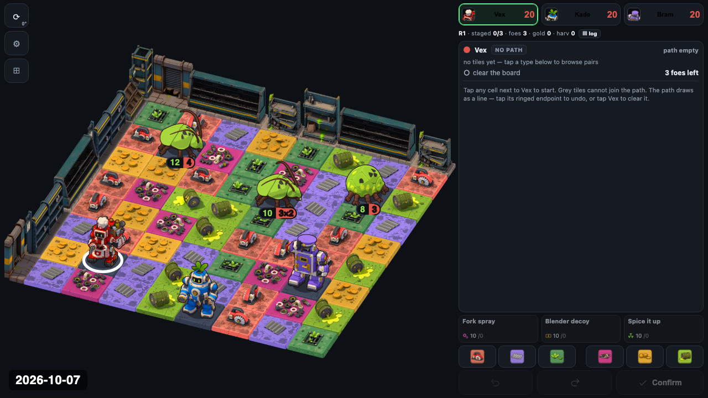

# Seven weeks in

*13 October 2026 · build 349*

This is the first post on the showcase, so it covers everything so far: from
a grid of coloured squares on 24 August to two illustrated chapters today. All
the images below come from the game's own history, each captured from the
build exactly as it stood at the end of that day.

## 24–28 August: is drawing a path any fun?

The first commit was a rules spec and the smallest thing that could test it:
a grid of tiles, three robots, and a path you draw across the tiles. The
tiles you walk over are the action. Red attacks, green gathers, purple
defends. Within a few days there were enemies with a turn of their own,
an action log, and rubble left behind where tiles were used up.

Then the board went isometric, got a rotatable camera, and moved to a
trimetric projection, because in plain isometric a sprite covers the tile
behind it. The camera became a real camera with an azimuth and an elevation
rather than a drawing trick. That decision paid off a month later, when the
art had to be rendered to match it.

## 26–27 September: levels, and abilities

After a month's break, levels became plain text files of any shape, and Vex
got its three abilities: *Fork spray*, *Blender decoy* and *Spice it up*.
An art spec was written down: camera angles, facings, anchors and canvas.
Anything drawn for the game has to fit those numbers.

## 29 September – 1 October: the art arrives

Three busy days. Vex, Kade and Bram arrived as 3D models rendered from eight
directions, with idle, walk and attack animations, and then death clips and
three idle variants each. The cockroach arrived too: it was a beetle in the
code until the art made it obvious what it was. The terrain went through
four versions: generated tiles, then a rebuild in Blender, then a new
weathered style, one tile type at a time, until the board's eight tile types
matched.

The control panel was rebuilt around portraits and big HP numbers, and the
first six levels of the supermarket were written as tutorials, one idea each.

## 2–7 October: from a board to a game

The game got a shell: a home screen, a level picker, intros and results. The
board got a world around it: broken shelves, toppled aisles, a checkout, a
chiller case, the front entrance. All are built at robot scale and placed
along the board's edges. Chapter 1 was rewritten as a rescue rather than a
shopping trip, and the story got its backbone.

Under the hood, the engine learned to run with the drawing switched off: the
same code drives all six chapter 1 levels in 21 ms. That made it possible to
measure levels instead of guessing, and to prove that a refactor changed
nothing.

## 10–13 October: chapter 2, the park

Every level now opens and closes on an illustrated still, with 26 sequences
across the first two chapters. Chapter 2 moves outdoors to a park that is
burning. Fire spreads through smouldering grass, can be doused, and leaves
scorched ground behind. It is Kade's chapter, the ember beetle arrives, and the park
has its own scenery: railings, hedges, raised beds, and compost bins that
something crawls out of.

## Next

Ability trees for all three robots are designed and waiting to be built, along
with the screen to choose them: a recipe book. Chapter 2's seven levels are a
first draft and still need playing.

*Builds: 349 · Campaign levels: 13 · Units: 12 · Story still sequences: 26*
